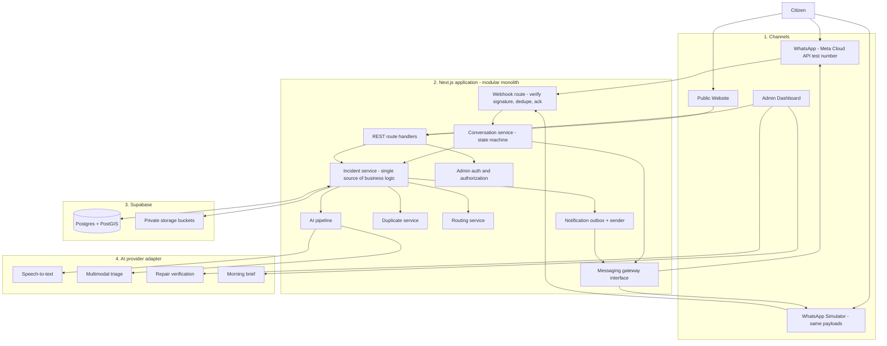
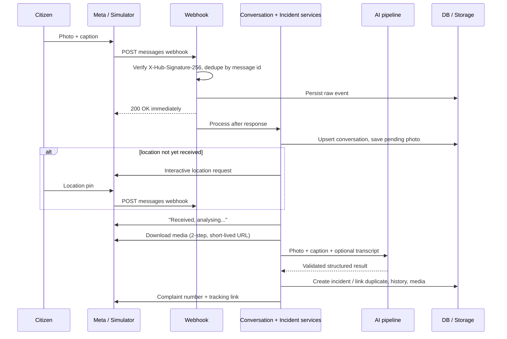
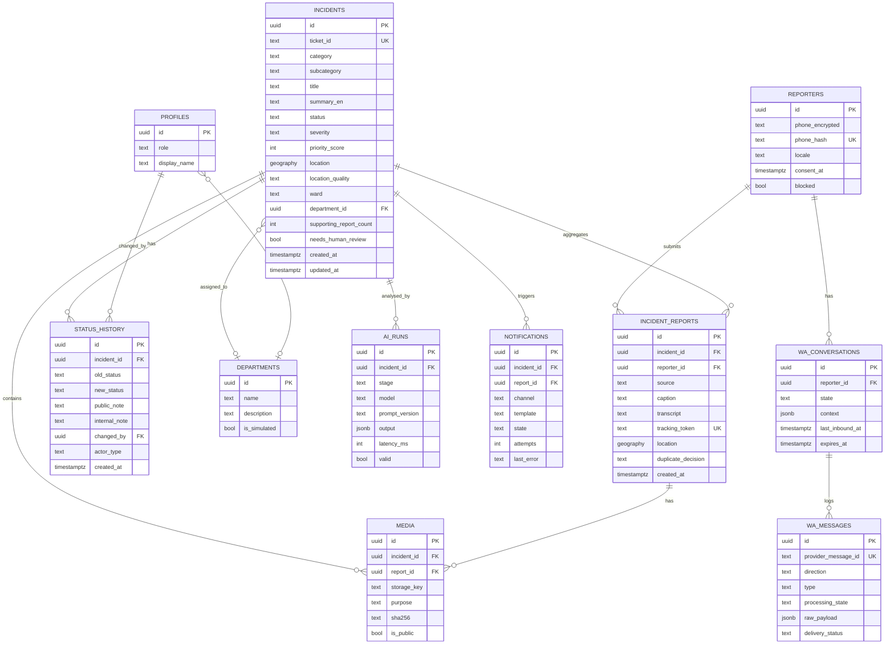

# Sudhaar — Project Specification and Coding-Agent Handoff (v2)

> **Purpose:** Single source of truth for AI coding agents and human contributors building Sudhaar as a **fresh project** in this folder within a 42-hour hackathon.
>
> **Tagline:** Report. Track. Resolve.
>
> **Initial geography:** Prayagraj, Uttar Pradesh, India.
>
> **Lineage:** v1 of this spec was a form-based reporting platform. v2 keeps its engineering rules and adds the product ideas proven in the earlier `civicDNA` prototype (photo + voice + location intake, AI triage, routing, before/after repair verification, AI morning brief). It makes **WhatsApp the primary citizen channel**. The `civicDNA` code is a reference for flow and UX only; **do not copy its code or its known defects** (see §16).

## 1. Product Overview

Sudhaar is an AI-assisted civic issue reporting and accountability platform. A citizen sends **one WhatsApp message — a photo, optionally with a caption or voice note, plus a location pin** — or fills a short mobile website form. Sudhaar analyses the photo and text, registers a complaint, replies with a **complaint number and a tracking link**, and keeps the citizen updated as authorized administrators triage, assign, resolve, and evidence the fix.

**Core value:** WhatsApp and web reports land in one shared incident system with AI triage, duplicate linking, routing to internal department queues, an auditable status history, evidence-backed resolution, and public transparency. It is not merely a complaint form.

### MVP principles

- Deliver one complete incident lifecycle (report → triage → assign → resolve → verify → notify) before optional features.
- WhatsApp, website, and admin dashboard use the **same backend services and database**. There is no second code path for WhatsApp.
- AI outputs are **suggestions**, validated server-side, and always overridable by a human.
- The system runs end-to-end **without** AI or WhatsApp credentials in local development (simulator + deterministic fallbacks), and says so in the UI when it does.
- Simulated department assignment is labelled as simulated; never claim government integration unless it exists.
- Never present seeded demo data, fallback AI output, or estimated figures as real civic impact.

## 2. Core User Journeys

### 2.1 WhatsApp (primary)

1. **Send:** Citizen sends a photo to the Sudhaar WhatsApp number. A caption (any language) and/or a voice note may accompany it. Citizen shares a **location pin** (WhatsApp sends location as a separate message type; it is not embedded in the photo).
2. **Acknowledge:** Bot immediately replies that the photo was received and is being analysed.
3. **Understand:** Backend downloads the media, runs image analysis combined with the caption/voice transcript, checks it is a civic issue, suggests category/severity/summary, routes to a department queue, and checks for nearby duplicates.
4. **Register:** An incident (or a supporting report on an existing incident) is created. The **citizen's identity is their verified WhatsApp number**; no account is required.
5. **Reply:** Bot sends the **complaint number** (e.g. `CIV-004217`), category, a one-line summary, the internal queue it was assigned to, and a **tracking link**.
6. **Update:** Status changes are pushed to the same chat (see §5.6 for the 24-hour window rule).
7. **Track later:** Citizen can message `status CIV-004217` or `my complaints`, or open the link.

### 2.2 Website

1. Citizen opens the mobile-first site, taps **Report a Problem**, takes or selects a photo, optionally adds a description or voice note, confirms the auto-detected location on a map, and submits.
2. The **same pipeline** as WhatsApp runs. The citizen sees the live analysis progress, then the complaint number and tracking link.
3. Optional **"Get updates on WhatsApp"** button opens a `wa.me` deep link pre-filled with `TRACK CIV-004217 <token>`. Sending it binds that WhatsApp number to the complaint (proves ownership and records consent).

### 2.3 Administrator

Reviews the prioritized queue and the AI morning brief, opens an incident (photos, AI reasoning, duplicates), assigns a department queue, moves status, adds public/internal notes, uploads **after-repair evidence**, reviews the AI verification opinion, and confirms closure.

### Example demo scenario

A citizen photographs a pothole near a school, captions it in Hindi, and shares a location pin. Sudhaar replies in under ~20 seconds with `CIV-004217`, "Road damage — pothole, High", "Assigned to: Roads & Public Works (demo queue)", and a tracking link. The admin opens the dashboard, assigns and starts work. The citizen receives a WhatsApp update. The admin uploads an after-photo; the AI gives an advisory opinion; the admin confirms closure; the citizen is notified.

Ticket IDs and incident details used in demos must be generated by the application or explicitly labelled illustrative.

## 3. System Architecture



### WhatsApp report sequence



### Component responsibilities

| Component | Responsibility |
| --- | --- |
| Next.js app (App Router, TypeScript) | Public site, admin dashboard, REST route handlers, webhook, server-side services |
| Messaging gateway interface | `send(text / template / interactive)` and `downloadMedia(id)`; two implementations: `MetaCloudGateway` and `SimulatorGateway` |
| Conversation service | Per-number state machine; turns inbound messages into incident-service calls |
| Incident service | The only place that creates incidents, validates transitions, writes history, enqueues notifications |
| AI pipeline | Transcription, multimodal triage, validation, deterministic fallback |
| Duplicate / Routing services | Deterministic geo + category matching; seeded department/ward data |
| Notification outbox | Persisted messages with retry; delivery outcome stored |
| Supabase | Postgres + PostGIS, Auth (admins only), private Storage |

**Architecture rule:** WhatsApp and the website must not have separate complaint tables or duplicate business logic. The simulator must drive the **real webhook handler**, not bypass it.

## 4. Technology Stack

Greenfield project; use this stack (chosen for speed in 42 hours and because the prototype validated it). Because Next.js changes between major versions, **read the installed version's docs in `node_modules/next/dist/docs/` before writing framework code**.

- **App:** Next.js (App Router) + React + TypeScript, single repo, single deployable
- **Styling/UI:** Tailwind CSS, shadcn/ui or equivalent accessible primitives
- **Database:** Supabase Postgres with **PostGIS** (`geography(Point,4326)` + GiST index; use `ST_DWithin` for nearby queries)
- **Auth:** Supabase Auth for administrators only. Citizens do not need accounts.
- **Storage:** Supabase Storage, **private buckets**, served via short-lived signed URLs
- **Validation:** Zod at every boundary (HTTP, webhook payloads, AI output)
- **Maps:** Leaflet + OpenStreetMap tiles (no paid key) — Mapbox optional
- **AI:** Provider-independent adapter. Default implementation mirrors the prototype (OpenAI chat model with vision + structured JSON output, and a Whisper-class transcription model); Gemini is an acceptable alternate. Model names come from env vars.
- **WhatsApp:** Meta WhatsApp Cloud API with the free test number; **simulator first**
- **Testing:** Vitest (+ Supertest or route-handler tests); Playwright optional for the demo path
- **Deployment:** Vercel (public HTTPS URL needed for the Meta webhook); a tunnel (cloudflared/ngrok) for local webhook testing

Prefer a modular monolith. Do not add microservices, Kafka, Redis, Kubernetes, or a vector database. A Postgres table is the queue.

## 5. Functional Requirements

### 5.1 Public website (mobile-first, bilingual EN/हिन्दी)

1. **Home:** what Sudhaar is; calls to action `Report a Problem`, `Track Complaint`, `View Nearby Issues`; public metrics only when backed by real data, with demo data labelled.
2. **Report flow (≤3 steps):**
   1. Photo (camera capture on mobile, or upload; client-side downscale/compress) + optional text + optional voice note (record in browser).
   2. Location: auto-detect via browser geolocation, shown on a map with a draggable pin and an optional landmark field. EXIF GPS in uploads may be used as a hint but is never trusted blindly.
   3. Submit → live progress ("Reading photo… Finding location… Routing…") driven by real pipeline state, not a fake timer → result card with complaint number, category, queue, and tracking link; "Get updates on WhatsApp" button.
   - Clear validation, loading, success, error, and retry states. Works on slow connections.
3. **Public issue map:** markers with category/status filters and public summaries. Public coordinates are rounded/jittered (~100 m) and never show reporter details.
4. **Tracking:**
   - `/t/<trackingToken>` (the link sent to the citizen): richer view — the citizen's own photo, status timeline, public notes, resolution evidence marked public.
   - Ticket-ID-only lookup: **minimal** public status (category, status, last updated, approximate area). No photos, no notes beyond public updates, no exact location.
5. **Accessibility:** semantic HTML, labels, keyboard navigation, visible focus, WCAG-AA contrast, `prefers-reduced-motion` respected, large touch targets.

### 5.2 WhatsApp bot

#### Message types handled (Meta Cloud API webhook `messages` field)

| Inbound type | Handling |
| --- | --- |
| `image` (with optional `caption`) | Starts or continues a report; media fetched by `image.id` |
| `location` | Supplies coordinates (and optional name/address) to the pending report |
| `audio` (voice note) | Transcribed; transcript treated as description text |
| `text` | Commands (`hi`, `help`, `status <ID>`, `my complaints`, `TRACK <ID> <token>`, `language hi/en`), a landmark/address reply, or a description for a pending photo |
| Other (video, document, sticker, contacts) | Polite "unsupported, please send a photo" reply |
| Status callbacks (`sent/delivered/read/failed`) | Stored against outbound messages; never create incidents |

> Verify exact payload shapes and the interactive location-request format against Meta's current Cloud API docs while implementing; do not rely on this table for field names.

#### Conversation rules

- **Identity:** the sender's `wa_id` from the verified webhook is the reporter identity. Store the number encrypted at rest plus a keyed hash for lookups. Never log it in plaintext; never return it from any API.
- **Location is not automatic.** WhatsApp strips EXIF from photos and sends location as its own message. Therefore:
  - Photo arrives **without** a recent location → create a `DRAFT` report, reply asking for location using the **interactive location-request message** ("Please tap to share the location of this problem"), and accept a typed landmark as a degraded fallback (`location_quality = LANDMARK_ONLY`, flagged for human review).
  - Location arrives **first** (within the last 10 minutes) → hold it and attach it to the next photo.
  - Photo + location both present → proceed with **no confirmation step**.
  - Draft expires after 24 hours with one reminder after ~15 minutes.
- **Extra photos** from the same number within ~2 minutes of a pending/just-created report attach to it as additional media.
- **Immediate acknowledgement** before slow AI work ("Got your photo, analysing — this takes ~15 seconds").
- **Not a civic issue / unusable photo** (selfie, screenshot, blurry, explicit): do not register; reply with what to send instead. Borderline/low confidence: register with `needs_human_review = true` and say so.
- **Success reply** (language follows the citizen's caption/`language` setting, default bilingual short form):
  - Complaint number, category, one-line summary, severity word (not a percentage), the internal queue (labelled as Sudhaar's queue), tracking link, and the hint "Reply `status` anytime."
  - Must **not** claim the government/municipality has received it.
- **Duplicate:** if linked to an existing incident, say "A similar issue nearby is already reported as CIV-…; your report has been added as supporting evidence" and still give the citizen their **own** report reference and tracking link.
- **Consent/privacy:** first reply to a new number includes a short notice (what is collected, why, how to stop). `STOP` / `delete my data` is honoured.
- **Rate limits:** per number (e.g. ≤10 reports/day, ≤30 messages/hour), per-image size cap, duplicate-image hash check. Over-limit replies are polite and cheap (no AI call).

#### Webhook requirements

- `GET` handshake with `hub.verify_token`; `POST` verifies `X-Hub-Signature-256` (HMAC-SHA256 with the app secret) **against the raw request body** before parsing.
- Respond `200` quickly; persist the raw event first; process after responding. Because serverless functions can be cut off, include a **processing-state column and a retry sweep** (cron/manual endpoint) for events stuck in `PENDING`.
- **Idempotency:** unique constraint on provider message id; Meta redelivers.
- Media download is two-step (resolve media id → authenticated download) and the URL is short-lived; store media in private Storage immediately.
- Outbound sends go through the gateway and are logged in `wa_messages` with provider id and delivery status.

#### Messaging windows and cost (to verify before relying on it)

- Free-form replies are generally allowed only within **24 hours of the citizen's last inbound message**. Later status updates require a **pre-approved template** message. Create the utility templates (status update, resolved) at the start of the project because approval can take time.
- Meta pricing and categories change; figures seen in vendor blogs conflict. Check Meta's current rate card before quoting any cost. Never put cost claims in the pitch without verifying.

#### Meta test-number setup (start at hour 0, in parallel)

A human owner should: create a Meta developer account and Business app, add the WhatsApp product, note the test number's phone-number-id, add up to the permitted number of recipient test numbers, create a long-lived **system-user access token** (the default temporary token expires within a day), configure the webhook URL + verify token, subscribe to `messages`, and copy the app secret. Test numbers have restrictions (recipient allow-list, template limits); confirm on the current docs. **Decision gate at hour ~20:** if the real number is not receiving webhooks reliably, the simulator is the demo path and Meta integration continues as a stretch goal.

#### Simulator (build first)

- A `/sim` page (dev/demo only, disabled in production unless a flag is set) that looks like a chat: send image + caption, send location (map click), record voice, type text, see bot replies including interactive buttons and link previews.
- It generates **Meta-shaped webhook payloads signed with the real signing logic** and POSTs them to the real `/api/v1/webhooks/whatsapp` handler. The `SimulatorGateway` stores "sent" messages for the page to poll.
- Simulated media is served by an internal mock media endpoint that mimics the two-step download.
- A banner always shows **"Simulated WhatsApp — no real message was sent"**.

### 5.3 Administrator dashboard

Authorized administrators must be able to:

- See a **prioritized queue** with filters (status, category, department, source, needs-review flag, age) and pagination.
- Read the **AI morning brief** (generated on a schedule or on explicit refresh, cached — never regenerated per page view).
- Open an incident: photos (signed URLs), caption/transcript, AI summary and **reasoning**, severity suggestion, duplicate/supporting reports, map, full history.
- Accept or override AI category/severity/department; overrides are stored with the previous value (training/evaluation data).
- Assign to a department queue; change status via validated transitions; add public update or internal note.
- Upload **after-repair evidence**, run the **verification opinion**, and confirm or reject closure (§5.7).
- Merge, split, mark duplicate, or reject with a mandatory reason.
- Flag abuse/spam (per reporter number and per image).

Demo department queues: roads/public works, municipal services/sanitation, drainage, water supply, electricity/street lights, enforcement. These are **demo queues, not official integration**.

### 5.4 AI-assisted processing

Present these as pipeline stages, not as a swarm of autonomous agents.

| Stage | Implementation | Notes |
| --- | --- | --- |
| 1. Intake | Deterministic | Normalise source, text, media, location, language |
| 2. Transcribe | AI (only if voice) | Keep original transcript and English summary; support Hindi |
| 3. Multimodal triage | **One** AI call (image + caption + transcript) | Returns the schema below |
| 4. Routing | Deterministic | Category → department queue; ward from seeded boundary polygons via PostGIS when available, else `UNKNOWN` |
| 5. Duplicate check | Deterministic | §5.5 |
| 6. Priority | Deterministic formula | Severity + supporting-report count + age + proximity flags |
| 7. Repair verification | AI, advisory | §5.7 |
| 8. Morning brief | AI over **computed aggregates** | Scheduled/cached |

**Triage output (validated with Zod; invalid → retry once → fallback):**

```json
{
  "isCivicIssue": true,
  "issueType": "ROAD_DAMAGE",
  "subcategory": "pothole",
  "severity": "HIGH",
  "severityReason": "Deep pothole spanning part of the carriageway.",
  "hazards": ["near pedestrian crossing"],
  "photoQuality": "GOOD",
  "captionConsistentWithPhoto": true,
  "detectedLanguage": "hi",
  "titleEn": "Large pothole on main road",
  "summaryEn": "Citizen reports a pothole that has been present for about 20 days.",
  "needsHumanReview": false,
  "reviewReason": null
}
```

Rules:

- Category must be in the fixed enum; severity in `LOW|MEDIUM|HIGH|CRITICAL`.
- **Do not show model "confidence" as a percentage.** If a number is stored, it is an unreliable hint; use buckets (`clear / uncertain`) in the UI.
- AI must not invent coordinates, declare a complaint verified, or autonomously close an incident.
- **No fabricated impact figures.** Do not output "2,430 citizens affected" or invented school/hospital counts. Instead show computed signals: supporting reports, days open, and — if OpenStreetMap data is loaded — "school within ~300 m (approx., OSM)". Anything estimated is labelled *approximate*.
- Resize/compress images before sending to the model; cap size and dimensions; strip EXIF from any image shown publicly.
- Store each AI run (inputs reference, model, prompt version, output, latency, validation result) in `ai_runs` for audit and cost tracking.
- **Fallback (no key, provider error, invalid output):** category = `OTHER`/keyword guess from caption, `needs_human_review = true`, title from caption or "Reported issue", and the UI/WhatsApp reply honestly says "automatic analysis unavailable — a person will review". In demo-without-key mode, output is labelled *simulated AI*; it must not return a canned "Pothole 96%" for arbitrary photos.

### 5.5 Duplicate detection

For the MVP compare, using PostGIS:

- Distance (`ST_DWithin`, default 75–150 m; configurable by category).
- Same category (or a defined compatible group).
- Recent creation time (default 21 days, only against non-closed incidents).
- Text/keyword similarity as a tiebreaker; image hash equality as a strong signal (optional perceptual hash).

Rules:

- Select the **best** candidate (nearest, then most similar), not the first match.
- **Never discard a citizen's report.** Every submission creates a row in `incident_reports` (its own photo, text, reporter, location, time). A duplicate is linked to the primary incident, increments its supporting-report count, and appears in its history. The reporter still gets their own reference and tracking link.
- Admins can unlink/merge. Linking decisions record score and reason.
- Low-confidence matches create a *candidate* shown to the admin instead of auto-linking.

### 5.6 Notifications

When an incident status changes:

1. Commit the new status and append status history **in one transaction**.
2. Insert notification rows into an outbox in the same transaction.
3. A sender worker/route attempts delivery via the gateway: WhatsApp free-form if inside the 24-hour window, otherwise an approved template; skip WhatsApp if no consent.
4. Record delivery outcome; retry transient failures with backoff; surface persistent failures to admins.
5. The website timeline reflects status through polling.

A failed notification must never roll back a committed status change.

### 5.7 Repair verification (before/after)

- Admin uploads an after photo (and the system records uploader, time, and — if provided — location).
- The verification call receives **both images** (before and after) plus the original summary. (The prototype only sent the after photo; do not repeat that.)
- Output is **advisory**: `looks_repaired | partially | not_repaired | cannot_tell` with a reason. It is never shown as a hard percentage.
- Guards: after photo must be taken within a reasonable distance of the incident when location is available; reject identical/reused images (hash).
- The incident moves to `RESOLVED_PENDING_VERIFICATION` on admin action; **an admin confirms closure** (`CLOSED`). If the AI says `not_repaired`, the UI warns and requires an explicit override reason.
- Optional: ask the citizen via WhatsApp "Is it fixed? Yes/No"; a "No" reopens the incident for admin review.

## 6. Logical Data Model

Adapt to Supabase/Postgres conventions. All tables have RLS **enabled with no anon/authenticated policies**; the app accesses data only through server-side code using the service role, and exposes data through sanitized API responses. (Do not use "allow everyone" demo policies — see §16.)



### Data rules

- Ticket ID: human-readable, from a DB sequence (e.g. `CIV-004217`). **Ticket IDs are guessable, so they are never authorization.** The unguessable `tracking_token` (≥128-bit random, URL-safe) authorizes the rich tracking view.
- UUIDs internally; UTC timestamps; localize in the UI (IST).
- Validate latitude/longitude ranges; reject locations far outside the service area flagged for review.
- Store phone numbers encrypted; keep a keyed hash for lookup; do not store in logs, URLs, AI prompts, or analytics.
- Index status, category, created_at, priority, and a GiST index on location.
- Statuses and transitions are enforced centrally in the incident service **and** with a DB check constraint.
- Preserve history; never overwrite. Record who/what changed status (`actor_type`: `admin|system|citizen`).
- Store file references, not binaries or base64, in rows. Buckets are private; public media is served only via signed URLs after an `is_public` check.
- Admin roles live in `profiles` and are set only by seed script or an existing-admin action. **Never trust a role (or any authorization field) from a request body.**

## 7. Incident Lifecycle

Statuses:

`REPORTED → TRIAGED → ASSIGNED → IN_PROGRESS → RESOLVED_PENDING_VERIFICATION → CLOSED`

plus `REOPENED`, `NEEDS_INFO`, `DUPLICATE`, `REJECTED`.

| From | Allowed to |
| --- | --- |
| `REPORTED` | `TRIAGED`, `NEEDS_INFO`, `REJECTED`, `DUPLICATE` |
| `TRIAGED` | `ASSIGNED`, `NEEDS_INFO`, `REJECTED`, `DUPLICATE` |
| `NEEDS_INFO` | `TRIAGED`, `REJECTED` |
| `ASSIGNED` | `IN_PROGRESS`, `TRIAGED` (reassign) |
| `IN_PROGRESS` | `RESOLVED_PENDING_VERIFICATION`, `ASSIGNED` |
| `RESOLVED_PENDING_VERIFICATION` | `CLOSED`, `REOPENED` |
| `CLOSED` | `REOPENED` (admin only) |
| `REOPENED` | `ASSIGNED`, `IN_PROGRESS` |

Define the table once in code (and mirror it in a DB constraint/function). Reject invalid transitions with a clear error. Every `REJECTED`, `DUPLICATE`, and override requires a reason and produces auditable history. Pipeline steps move `REPORTED → TRIAGED` automatically; everything after that is a human action.

## 8. REST API Contract

Prefix `/api/v1`. All inputs validated with Zod; consistent error shape `{ "success": false, "error": { "code", "message" } }`.

| Method | Endpoint | Auth | Purpose |
| --- | --- | --- | --- |
| `POST` | `/reports` | public, rate-limited | Create a web report (multipart: photo, text, voice, lat/lng, landmark) → returns `{ticketId, trackingToken, status}`; analysis runs async |
| `GET` | `/reports/:trackingToken/progress` | token | Pipeline progress for the live "analysing" UI |
| `GET` | `/track/:trackingToken` | token | Rich citizen tracking view |
| `GET` | `/track/ticket/:ticketId` | public, rate-limited | Minimal public status |
| `GET` | `/map/incidents` | public | Approximate-location markers with filters |
| `GET` | `/incidents` | admin | Filtered, paginated queue |
| `GET` | `/incidents/:id` | admin | Full incident detail |
| `PATCH` | `/incidents/:id/status` | admin | Validated transition + notes |
| `PATCH` | `/incidents/:id/assignment` | admin | Assign department |
| `PATCH` | `/incidents/:id/triage` | admin | Override AI category/severity |
| `POST` | `/incidents/:id/duplicate-decision` | admin | Link / unlink / merge |
| `POST` | `/incidents/:id/evidence` | admin | Upload after-photo |
| `POST` | `/incidents/:id/verify` | admin | Run advisory verification |
| `GET` | `/admin/overview` | admin | Counts and computed aggregates |
| `GET` / `POST` | `/admin/brief` | admin | Cached brief / explicit regenerate |
| `GET` | `/departments` | public | Department queue names (public fields only) |
| `GET` / `POST` | `/webhooks/whatsapp` | Meta signature | Handshake and events |
| `POST` | `/internal/jobs/sweep` | secret header | Retry stuck webhook events and notifications |
| `POST` | `/sim/send` | dev flag only | Simulator → builds signed payloads → calls the real webhook handler |
| `GET` | `/health` | public | Health check (no secrets) |

### Create web report (illustrative)

Request (multipart fields): `photo`, `description`, `voice` (optional), `latitude`, `longitude`, `landmark`, `locale`.

Response (illustrative; server generates all IDs and timestamps):

```json
{
  "success": true,
  "data": {
    "ticketId": "CIV-004217",
    "trackingUrl": "https://<host>/t/<trackingToken>",
    "status": "REPORTED"
  }
}
```

### API standards

- **No unauthenticated endpoint may return private fields**: phone numbers, reporter identity, private notes, exact coordinates, raw AI payloads, or non-public media.
- Admin endpoints authenticate the session and check the admin role **server-side**, every request.
- Limit and validate upload type, size, and content; generate safe storage keys.
- Paginate lists; cap page sizes.
- Rate-limit public submission, tracking, login, and webhook-adjacent endpoints.
- Never expose provider errors, secrets, or stack traces.

## 9. Security, Privacy, and Trust

1. Authentication on the admin dashboard and every write route; server-side role check.
2. **Admin accounts cannot be self-registered.** There is no public registration that accepts a role.
3. RLS enabled on all tables with deny-by-default; service-role key only in server code; anon key never grants data access.
4. Webhook: signature verification on raw body, constant-time compare, idempotency, replay tolerance.
5. Secrets only in environment variables; startup **fails** in production if `AUTH`-related or signing secrets are missing (no built-in default secrets); `.env` never committed.
6. Phone numbers encrypted at rest; excluded from logs, prompts, URLs, analytics, public APIs.
7. Tracking tokens are random and unguessable; ticket ID alone gives minimal info only.
8. Approximate public coordinates; EXIF stripped from public images; private evidence behind signed URLs.
9. Treat all AI output as untrusted: schema-validate, enum-restrict, length-limit. Treat captions/transcripts/images as **untrusted prompt input** — instructions inside them must not change system behavior (prompt-injection awareness).
10. Abuse controls: per-number and per-IP rate limits, size caps, spam/abuse flags, ability to block a number, daily AI spend cap.
11. Consent notice on first WhatsApp contact; opt-out honoured; data-deletion path. Align with India's DPDP Act 2023 principles (purpose limitation, minimisation); get a proper legal review before real deployment.
12. Do not imply a government department has received or accepted a complaint if it exists only in Sudhaar's internal queue.
13. Record who changed status/assignment and when.

## 10. Suggested Repository Structure

```text
sudhaar/
├── src/
│   ├── app/
│   │   ├── (public)/             home, report, t/[token], track, map
│   │   ├── admin/                login, dashboard, incidents/[id]
│   │   ├── sim/                  WhatsApp simulator (dev/demo flag)
│   │   └── api/v1/               route handlers (thin; call services)
│   ├── components/
│   ├── lib/
│   │   ├── incidents/            service, transitions, priority, tracking tokens
│   │   ├── conversation/         WhatsApp state machine, commands, reply templates (en/hi)
│   │   ├── messaging/            gateway interface, meta.ts, simulator.ts, signature.ts
│   │   ├── ai/                   adapter, triage, transcribe, verify, brief, schemas, fallback
│   │   ├── duplicates/
│   │   ├── routing/              departments, ward lookup
│   │   ├── notifications/        outbox, sender, windows/templates
│   │   ├── storage/              private uploads, signed URLs, EXIF strip
│   │   ├── auth/                 admin session + role guard
│   │   ├── security/             rate limit, crypto, env validation
│   │   └── i18n/
│   └── middleware.ts
├── supabase/
│   ├── migrations/
│   └── seed/                     departments, demo incidents (flagged is_demo), admin bootstrap script
├── tests/
├── docs/                         ARCHITECTURE.md, API.md, WHATSAPP_SETUP.md, DEMO_SCRIPT.md
├── .env.example
└── README.md
```

This is a target, not a mandate; keep files small, and keep services free of HTTP/React imports so the web route, WhatsApp conversation, and tests all call the same functions.

## 11. Environment Configuration

`.env.example` with placeholders only:

```dotenv
NODE_ENV=development
PUBLIC_BASE_URL=http://localhost:3000

NEXT_PUBLIC_SUPABASE_URL=
NEXT_PUBLIC_SUPABASE_ANON_KEY=
SUPABASE_SERVICE_ROLE_KEY=

# AI (optional: fallbacks work without these)
AI_PROVIDER=
AI_API_KEY=
AI_TRIAGE_MODEL=
AI_TRANSCRIBE_MODEL=
AI_DAILY_SPEND_CAP=

# WhatsApp (optional: simulator works without these)
WHATSAPP_MODE=simulator            # simulator | meta
WHATSAPP_VERIFY_TOKEN=
WHATSAPP_ACCESS_TOKEN=
WHATSAPP_PHONE_NUMBER_ID=
WHATSAPP_APP_SECRET=
SIM_SIGNING_SECRET=
ENABLE_SIMULATOR=true

# Security
PHONE_ENCRYPTION_KEY=
PHONE_HASH_KEY=
JOBS_SECRET=
```

- Never put real secrets in the example. The app must start without AI and WhatsApp credentials.
- Seed data through an explicit command and mark it `is_demo`.
- Create the first admin through a one-time script reading credentials from the environment — never a hard-coded password, never self-signup.

## 12. UI and Design Direction

Professional civic-tech, not a generic admin template. Take inspiration from the prototype's deep ink/indigo + teal feel and the "agent progress" idea, but keep the following:

- Palette: navy/ink base, teal/green for progress, amber for attention, red for critical. One status colour mapping used identically everywhere.
- **Citizen UX priority:** one primary action per screen, big buttons, plain language, Hindi toggle always visible, minimal typing, photo-first.
- Live analysis progress that reflects **real** pipeline state; honest copy when AI is unavailable.
- Status timeline with plain-language labels (not internal enums), timestamps in IST, and public notes.
- Public map with clustering, filters, and approximate locations.
- Admin: dense, keyboard-friendly queue; side-by-side photo + AI reasoning; clear visual difference between AI suggestion and human decision.
- Skeletons, empty states, error states, offline/slow-network messaging.
- Subtle purposeful motion only.
- Label seeded/simulated data in the UI (e.g. "Demo data", "Simulated queue").

## 13. 42-Hour Buildathon Plan

Work starts with the **human owner kicking off Meta setup in parallel** (§5.2), since external approval is the main schedule risk.

| Hours | Focus | Deliverable |
| --- | --- | --- |
| 0–3 | Foundation | Next.js + Supabase project, env validation, migrations (core tables + PostGIS), RLS deny-by-default, admin bootstrap script, health route. **Human: Meta app, test number, webhook tunnel, submit message templates.** |
| 3–10 | Core incident engine | Incident service, ticket IDs, tracking tokens, transitions + tests, status history, notification outbox, public minimal tracking, map API |
| 10–16 | AI pipeline | Adapter, triage schema + validation, transcription, fallback, `ai_runs`, routing, priority score, duplicate service with tests |
| 16–23 | WhatsApp via simulator | Gateway interface, webhook handler (signature, idempotency, raw-event persist), conversation state machine, location request flow, replies (en/hi), `/sim` page. **Full WhatsApp journey working in the simulator.** |
| 23–30 | Web + admin UI | Mobile report flow with live progress, tracking page, public map, admin queue/detail/assignment/status, evidence upload, advisory verification, cached brief, Hindi toggle |
| 30–35 | Real WhatsApp | Switch `WHATSAPP_MODE=meta`, real media download, outbound via Cloud API, templates for out-of-window updates, `wa.me` binding. **Decision gate at ~hour 20 may already have shifted this to stretch.** |
| 35–40 | Hardening | End-to-end tests, privacy and security review (§16 checklist), rate limits, error states, demo seed, README/WHATSAPP_SETUP docs |
| 40–42 | Demo | Deploy, rehearse exact flow, record fallback video, architecture slide |

### Must-have

- WhatsApp (real or simulator) photo+location → analysed → complaint number + tracking link reply.
- Web report with the same pipeline and result.
- Persistence, history, tracking token view, minimal ticket lookup.
- Admin auth (no self-signup), queue, assignment, validated status changes.
- AI triage with honest fallback.
- Duplicate linking that preserves every report.
- WhatsApp status notification (simulator at minimum) with failure isolation.
- Public approximate map.
- Security basics and tests (§16).

### Optional

- Real Meta number end-to-end, template-based out-of-window updates.
- Advisory before/after verification (strongly recommended — it is the signature feature; do it after the must-haves).
- Citizen "is it fixed?" confirmation.
- OSM nearby school/hospital signals; ward polygons.
- Perceptual image similarity; multilingual beyond EN/हिन्दी.
- Analytics/heatmaps; realtime push.

If behind schedule, cut in this order: analytics → OSM signals → perceptual hashing → verification polish → real Meta integration (keep simulator). Do **not** cut persistence, tracking, admin authorization, the end-to-end demo, or the privacy basics.

## 14. Parallel Work With AI Coding Agents

One repo, one spec, explicit file ownership; do not ask both agents to build everything.

- **Serial first (one agent):** repo setup, migrations, shared types, incident service signatures, API contract, env validation.
- **Agent A — Citizen & admin UI:** `src/app/(public)`, `src/app/admin`, `src/components`, `src/lib/i18n`. Calls only the documented API.
- **Agent B — Backend & data:** `src/lib/incidents`, `duplicates`, `routing`, `notifications`, `storage`, `auth`, `security`, `supabase/`, route handlers under `api/v1` (except webhook/sim).
- **Agent C — AI & WhatsApp:** `src/lib/ai`, `src/lib/messaging`, `src/lib/conversation`, `api/v1/webhooks`, `src/app/sim`.
- **Human owner:** Meta setup, contract approval, secrets, integration, security review, deployment, demo acceptance.

Git rules: `main` stays working; feature branches/worktrees; bounded tasks; tests plus a changed-files summary; merge one feature at a time and run integration tests; no two agents edit the same file; commit a baseline before parallel work.

## 15. Master Prompt for Coding Agents

> You are an engineering agent contributing to Sudhaar, an AI-assisted civic issue reporting platform for Prayagraj, India, built in a 42-hour hackathon. The primary citizen channel is WhatsApp (photo + caption/voice + location pin → complaint number + tracking link); the website uses the same backend.
>
> **Source of truth:** Read `PROJECT_SPEC.md` first, then inspect the repository and git state. Preserve existing working code and agreed contracts. If the code conflicts with the spec, explain the conflict and propose the smallest practical change. Read the installed Next.js version's docs before writing framework code.
>
> **Rules:**
> - TypeScript everywhere; Zod at every boundary (HTTP, webhook payloads, AI output).
> - One incident service. WhatsApp, web, and admin call the same functions. The simulator drives the real webhook handler.
> - Never accept a role or any authorization field from the client. No self-registered admins. RLS deny-by-default; service role only on the server.
> - No unauthenticated endpoint returns private data (phone, exact location, internal notes, raw AI payloads, private media).
> - Verify webhook signatures on the raw body; dedupe by provider message id; acknowledge fast and process after.
> - AI output is a suggestion: validate, enum-restrict, store the run, fall back honestly. No fabricated impact numbers, no canned "AI" results presented as real, no percentage "confidence" shown to users.
> - Never discard a citizen report; duplicates are linked, not deleted.
> - Status changes go through the central transition table inside a transaction that also writes history and notification outbox rows. Notification failure never rolls back a status change.
> - Do not claim government integration. Label simulated queues, seed data, and simulated WhatsApp.
> - Keep secrets and phone numbers out of source, logs, URLs, and prompts.
> - Prefer small, testable changes over broad rewrites.
>
> **Working protocol:** Before coding, summarise repository findings, scope, dependencies, and a minimal plan. After coding, run tests, type checks, and lint, and report actual results — do not claim anything passed unless you ran it. Report changed files, key decisions, and known limitations. Do not implement unrelated features or discard another contributor's work.

## 16. Lessons From the civicDNA Prototype (do not repeat)

An audit of the prototype found these defects; each has a requirement above and a test below.

| Prototype issue | Required behaviour in Sudhaar |
| --- | --- |
| Registration accepted `role: "admin"` from the request body | No role input anywhere; admins by bootstrap script only |
| `GET /api/issues` and `/api/issues/[id]` were public and returned names, coordinates, transcripts, and base64 photos | Public endpoints return sanitized fields only |
| Supabase RLS policies allowed anyone to update/insert | Deny-by-default RLS; server-only data access |
| Hard-coded default session secret | Fail at startup if secrets are missing |
| Status route accepted any status string | Central transition table + DB constraint |
| "Before vs after" verification sent only the after image (before was pasted into text) | Send both images; advisory result; admin confirms closure |
| Impact agent returned invented citizen/school/hospital counts | Computed signals only; estimates labelled approximate |
| Ward derived from `latitude * 7`; officers were role names | Real seeded wards/departments or `UNKNOWN`; label demo queues |
| Demo mode returned a fixed "Pothole 96%" for any photo | Labelled simulated AI, or fallback to human review |
| Duplicate merge discarded the new report and used the first match | Keep every report; pick best candidate; admin can unlink |
| Missing GPS defaulted to a fixed Prayagraj coordinate | Missing location → ask the citizen / mark unverified |
| Photos stored as base64 in table rows | Private Storage + references |
| Executive brief regenerated on every dashboard load | Scheduled/cached brief over computed aggregates |
| No tests, in-memory fallback state | Tests for the critical paths below; persistent DB only |
| Docs said Gemini/Mapbox but code used OpenAI and had no map | Keep docs and code aligned; this spec names the real stack |

## 17. First-Checkpoint Demo Script (3–4 minutes)

1. Open the public site; show the approximate-location map.
2. On a phone (real WhatsApp if ready, otherwise the simulator): send a pothole photo with a Hindi caption and a location pin.
3. Show the instant acknowledgement, then the reply with **complaint number and tracking link** (~15–20 s).
4. Open the tracking link: show AI summary, category, queue (labelled demo), timeline.
5. Send a second photo of the same pothole from another test number: show the duplicate being **linked** while the second citizen still gets their own reference.
6. Admin dashboard: show the prioritized queue and cached morning brief; open the incident, show photo + AI reasoning, assign a queue, move to `IN_PROGRESS`.
7. Show the WhatsApp status update arriving in the chat; show the tracking page updated.
8. Upload an after-photo: show the advisory verification, confirm closure, show the final notification.
9. Mention (and optionally show) the website path producing the same result, and the privacy model: no phone numbers or exact addresses in public views.

## 18. Final Acceptance Checklist

- [ ] Repository starts using documented instructions; migrations and seed work.
- [ ] A WhatsApp-style photo + location message creates an incident and returns complaint number + tracking link.
- [ ] Photo without location triggers a location request; location-first and extra-photo cases behave per §5.2.
- [ ] Web report runs the same pipeline and shows the same result.
- [ ] Tracking token view works; ticket-only lookup returns minimal data.
- [ ] Incident and history persist across restarts.
- [ ] No role field is accepted from any request; no self-service admin creation.
- [ ] Admin routes enforce authentication and role server-side.
- [ ] Anon/public clients cannot read or write tables directly (RLS test).
- [ ] Public APIs contain no phone numbers, exact coordinates, private notes, or non-public media (automated test).
- [ ] Invalid status transitions are rejected; every transition has history.
- [ ] Webhook rejects bad signatures; replayed message ids are processed once.
- [ ] AI failure/absence produces a human-review incident and an honest reply, not a crash or fake result.
- [ ] Duplicate candidates never delete a report; both reporters keep their references.
- [ ] Notification failure does not undo a status change; failures are recorded and retried.
- [ ] Verification receives both images and cannot auto-close an incident.
- [ ] Rate limits and upload limits are enforced.
- [ ] Mobile report and tracking flows work in English and Hindi.
- [ ] Simulator mode clearly labelled; works with no external credentials.
- [ ] End-to-end demo rehearsed successfully.

## 19. Test Plan (minimum)

- **Unit:** transition table; priority formula; tracking-token generation; phone hashing/encryption; duplicate scoring; conversation state machine (all orders of photo/location/text); AI schema validation and fallback.
- **Route/integration:** webhook signature and idempotency; web report end-to-end with a mocked AI provider; admin authorization on every admin route; public endpoint field allow-lists; RLS deny test against the real database; notification failure isolation; rate-limit behaviour.
- **AI contract tests:** recorded fixtures for 6–10 representative photos/captions (including a non-civic image and a prompt-injection caption).
- **Manual:** real Meta number round-trip, template message outside the 24-hour window, slow-network web report.

## 20. Immediate Next Steps

1. Create the fresh Next.js project in this folder; commit a baseline.
2. **Human owner starts the Meta setup now** (developer account, business app, test number, recipients, system-user token, message templates) while engineering proceeds against the simulator.
3. One agent establishes migrations, env validation, shared types, the incident service signature, and the API contract; get it approved.
4. Assign Agents A/B/C by file ownership (§14) and integrate daily with the same report taken from WhatsApp/simulator through admin resolution.

**Primary success criterion:** one reliable, demonstrable lifecycle — a citizen sends a photo on WhatsApp and gets a complaint number and tracking link, an admin resolves it with evidence, and the citizen is told — is worth more than a large collection of partially working features.
